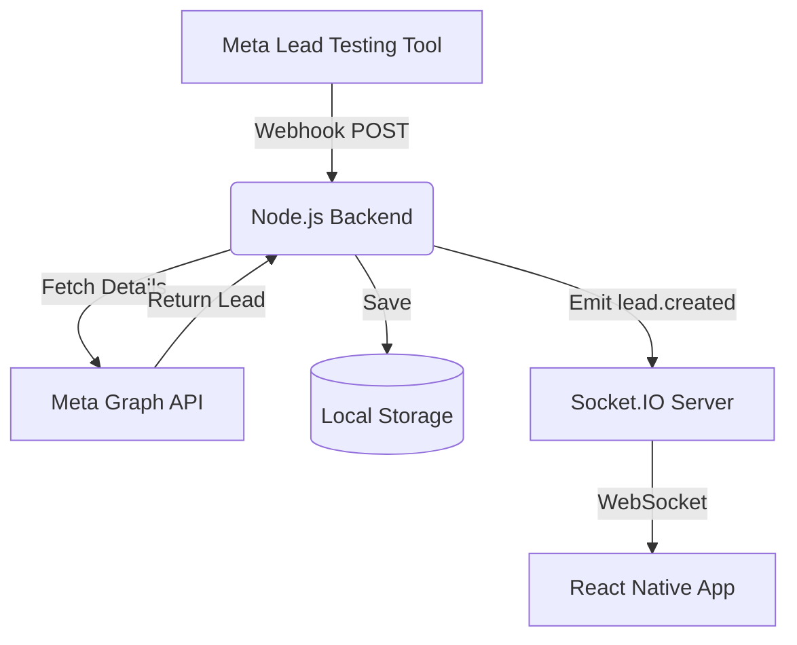

# Meta Lead Ads + React Native Proof of Concept

This is a complete working Proof of Concept (PoC) demonstrating how to receive leads from Meta Lead Ads in real-time and push them directly to a React Native application using WebSockets.

## Architecture

The system uses a Node.js/Express backend to receive webhooks from Meta, process the data, store it locally, and instantly broadcast the new lead to any connected mobile clients via Socket.IO.



## Tech Stack

- **Mobile**: React Native (Expo)
  - *Reasoning for Expo*: Expo provides the simplest, most reliable setup for a PoC without needing complex native environment configuration. It fully supports `socket.io-client` and standard networking, which satisfies all assignment requirements without compromising the demonstration.
- **Backend**: Node.js, Express, TypeScript
- **Real-time**: Socket.IO
- **Storage**: Local JSON file store (sufficient for this PoC to persist leads across restarts)

## Project Structure

- `backend/`: Express server, webhook handling, and Socket.IO server.
- `mobile/`: React Native (Expo) application.

## Setup Instructions

### 1. Backend Setup

1. Navigate to the backend folder:
   ```bash
   cd backend
   npm install
   ```
2. Copy the `.env.example` to `.env`:
   ```bash
   cp .env.example .env
   ```
3. Update `.env` with your Meta credentials (optional for testing with mock data):
   - `META_VERIFY_TOKEN`: Your chosen verification token.
   - `META_ACCESS_TOKEN`: Page access token with `leads_retrieval` permission.
4. Start the development server:
   ```bash
   npm run dev
   ```

### 2. Exposing the Backend (for Meta Webhooks)

To receive webhooks from Meta, your local backend must be publicly accessible. Use a tool like `ngrok` or `cloudflared`:

```bash
ngrok http 3000
```
Note the HTTPS URL provided by ngrok (e.g., `https://abcdef.ngrok-free.app`).

### 3. Meta Developer Setup

1. Go to [Meta for Developers](https://developers.facebook.com/).
2. Create/select your app.
3. Add the **Webhooks** product.
4. Subscribe to the **Page** object.
5. Set the Callback URL to your ngrok URL + `/webhook/meta` (e.g., `https://abcdef.ngrok-free.app/webhook/meta`).
6. Enter the `META_VERIFY_TOKEN` you set in your `.env`.
7. Subscribe to the `leadgen` field.

### 4. React Native Setup

1. Navigate to the mobile folder:
   ```bash
   cd mobile
   npm install
   npm install socket.io-client axios
   ```
2. Update the `BACKEND_URL` in `mobile/App.tsx` if you are running on a physical device. For local iOS simulator, `http://localhost:3000` works. For Android emulator, use `http://10.0.2.2:3000`. If you have the ngrok URL, you can also use that!
3. Start Expo:
   ```bash
   npx expo start
   ```
4. Press `i` to open in iOS simulator, or `a` for Android emulator.

## Testing the Flow

The actual assignment requires testing the integration using Meta's Lead Testing Tool.

### Demo Instructions:
1. Start the **backend**.
2. Start the **React Native app** and keep the Leads screen OPEN.
3. Open the [Meta Lead Ads Testing Tool](https://developers.facebook.com/tools/lead-ads-testing) in your browser.
4. Select your Page and Form.
5. Click **Create lead**.
6. **Watch the React Native app**: The new lead will appear automatically on the screen within seconds, without touching or refreshing the device!

### Troubleshooting

- **Webhook not receiving**: Ensure your ngrok tunnel is running and the Callback URL in the Meta Developer Portal is correct. Check backend console logs.
- **Lead not appearing in app**: Check if the mobile app shows "● Connected". If it's disconnected, verify the `BACKEND_URL` in `App.tsx`.
- **Graph API Error**: If you see errors fetching lead details, ensure your `META_ACCESS_TOKEN` is correct. (If no token is provided, the backend falls back to generating a mock lead based on the ID for testing purposes).
- **Duplicate Leads**: The backend uses the Meta Lead ID to prevent duplicate processing, so clicking "Create lead" repeatedly in the tool may require you to delete the test lead first before creating a new one.

## Assumptions & Limitations

- This is a PoC; a production app would use a real database (PostgreSQL/MongoDB) instead of a local JSON file.
- We assume a single Meta Page for this demonstration.
- No authentication UI is built for the app as the focus is on lead ingestion and real-time delivery.
